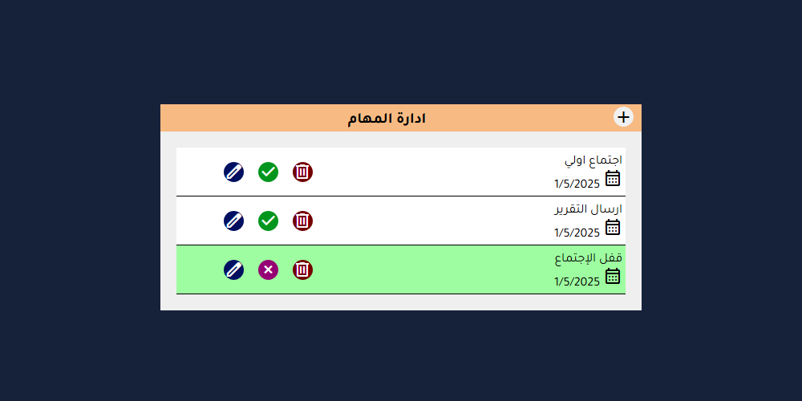

# To-Do List

A task manager in plain JavaScript, HTML and CSS with an Arabic (right-to-left) interface. Tasks are saved in the browser's `localStorage`, so they are still there after the page is refreshed.


> **Type:** learning project for DOM manipulation and browser storage.



## Features

- Add a task (the date is filled in automatically).
- Edit a task's title.
- Mark a task as done or not done (completed tasks are highlighted).
- Delete a task, with a confirmation step.
- Persistence with `localStorage`: tasks are stored as JSON and loaded on start.

## How It Works

All tasks live in one array of objects, each with a title, a date and an `isDone` flag. Every action changes the array, saves it to `localStorage` with `JSON.stringify`, and then redraws the list from the array. Storage and rendering are each kept in one function (`storeTasks`, `fillTaskOnPage`) so the logic isn't repeated.

## Project Structure

```text
To-Do-List/
├── index.html   # layout
├── style.css    # styles
├── main.js      # task logic, rendering and localStorage
└── docs/screenshot.png
```

## How to Run

No build step or dependencies. Clone the repository and open `index.html` in a browser:

```bash
git clone https://github.com/Re7absu/To-Do-List.git
```

Fonts and icons load from Google Fonts, so an internet connection is needed for the full look.

## Future Improvements

- Replace `prompt()`/`confirm()` with in-page forms and dialogs.
- Filter by status and sort by date.
- Escape task titles before inserting them into the page.

## License

Released under the [MIT License](LICENSE).
